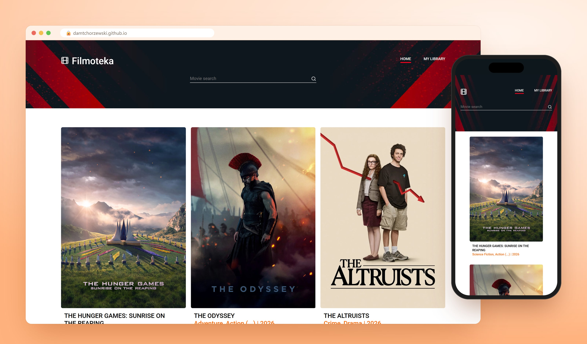
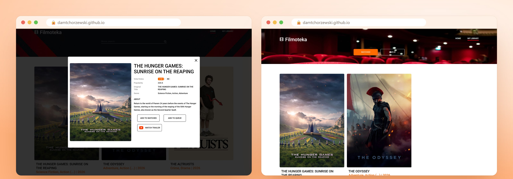
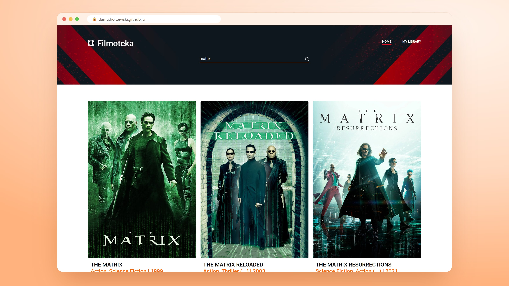
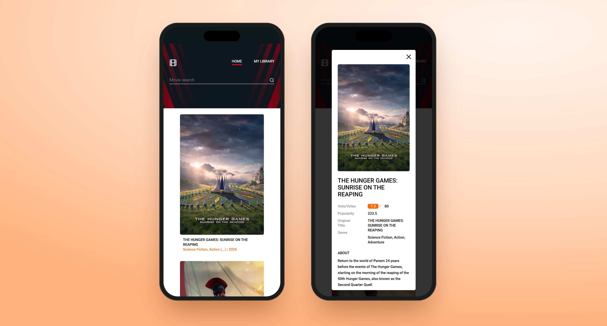

<p align="center">
  <picture>
    <source media="(prefers-color-scheme: dark)" srcset="docs/images/banner-dark.png">
    
  </picture>
</p>

<p align="center">
  
</p>

## About

<a href="https://damtchorzewski.github.io/Filmoteka-HiFiveTeam/"></a>

The "Filmoteka" website created by the HiFiveTeam team is a place where you can find reviews and descriptions of films
that are worth watching. It is an ideal source of inspiration for cinema lovers and people who want to expand their
knowledge of the film world. Intuitive and clear navigation will allow you to quickly find the videos you are
interested in and read the descriptions or watch the trailer.

- **Trending films.** The home page shows the trends of the day with pagination; each film is a card with the basic
  information.
- **Search.** Find films by title, with pagination of the results (`search.js`, `pagination.js`).
- **Film details.** A click on a card opens a window with the full information about the film.
- **Trailers.** The details window plays the trailer in a lightbox (`trailer.js`, BasicLightbox).
- **Watched and queue.** Films are added to the "watched" and "queue" lists; the buttons in the window update their
  state when the lists change (`btn-modal.js`, `refresh.js`).
- **My library.** A separate page with both lists and a switch between them; the lists are kept in the browser's
  Local Storage (`local-storage.js`, `my-library.js`).
- **The team window.** The footer opens the window with the people who made the site (`modal-team.js`).
- **Deployed by Actions.** A push to `main` builds the site and publishes it to the `gh-pages` branch.

The goals of the project: a responsive design adapted to different devices, readable and organised code, and working
features with intuitive interaction.

> **Status:** a finished course project. The film data comes from The Movie Database (TMDb), so the posters and the
> trending list change over time.

## Tech stack

|          |                                                                                                                       |
| -------- | --------------------------------------------------------------------------------------------------------------------- |
| Stack    | HTML5 in partials (`posthtml-include`), SASS, JavaScript ES6+ modules; [Parcel 2](https://parceljs.org/)             |
| UI       | `modern-normalize`, `tui-pagination`, BasicLightbox (trailers), Notiflix (notifications)                              |
| Data     | Fetch API against [The Movie Database](https://www.themoviedb.org/documentation/api) (v3); Local Storage for the lists |
| Tests    | none                                                                                                                  |
| Hosting  | GitHub Pages, `gh-pages` branch, published by GitHub Actions (`.github/workflows/deploy.yml`)                         |

The content is in English; code and commits are in English.

## Screenshots

<p align="center">
  
</p>
<p align="center">
  
</p>
<p align="center">
  
</p>

## Quick start

```bash
git clone https://github.com/DamTchorzewski/Filmoteka-HiFiveTeam.git
cd Filmoteka-HiFiveTeam
npm install
npm start      # http://localhost:1234
```

Requirements: Node.js LTS and npm. Parcel reloads the page when a file changes.

## Scripts

| Command         | What it does                                                                           |
| --------------- | -------------------------------------------------------------------------------------- |
| `npm start`     | development server with live reload (`parcel src/*.html`)                              |
| `npm run build` | production build to `dist/` with the public URL `/Filmoteka-HiFiveTeam/` (what the workflow runs) |

## Configuration

No environment variables. The base address and the (v3) API key of The Movie Database are constants at the top of
`src/js/api.js`; this is a static site, so the key is visible in the browser whichever way it is supplied. The public
URL of the build is the `--public-url /Filmoteka-HiFiveTeam/` argument of the `build` script; change it when the
repository is renamed.

## Structure

The project is organised in small modules, which makes the code easier to manage and extend.

```
src/index.html, library.html  ★ the two pages (home, My library); they include the partials below
src/partials/                 header (and library header), gallery, pagination, footer, loader, movie and team windows
src/sass/                     styles in SASS, compiled by Parcel
src/images/                   logo, icons.svg, the header and gallery pictures, the photos of the team
src/js/
  index.js, library.js        entry modules of the home page and of My library
  api.js                      ★ communication with The Movie Database: trending, search, details, trailers
  btn-modal.js                the buttons that add a film to "watched" and "queue" (Local Storage)
  genres.js                   the film genres, to map genre identifiers to names
  loader.js                   shows and hides the animated loader
  local-storage.js            keeps the "watched" and "queue" lists
  modal-movie.js              shows and hides the window with the film details
  modal-open-close.js         opens and closes a window: Escape, a click outside
  modal-team.js               the window with the team
  my-library.js               the user's library: "watched" and "queue" and the switch between them
  pagination.js               pagination of search results and of trending lists
  refresh.js                  updates the state of the add buttons after the lists change
  refs.js                     references to DOM elements, shared by the modules
  render-movie-cards.js       renders the film cards on the home page and in the library
  render-movie-details.js     renders the film details in the window
  scroll-top.js               scrolls the page to the top
  search.js                   the title search, with pagination
  trailer.js                  shows the trailer in a window
  trending-movies-pagination.js  pagination of the trending films
assets/                       images of the Parcel template and of the first README (not used by the page)
docs/                         repository description; docs/images/ holds the README images (generated)
.github/workflows/            deploy.yml: build, and publish to the gh-pages branch from main
```

## Branches and workflows

Shared standards from `reops/standards`: `main` ≤ `develop` ≤ a working branch `<type>/<topic>`, Conventional
Commits in English. `deploy.yml` builds every push to `main` and publishes the result to `gh-pages`. Details:
`reops/standards/git.md` and `reops/standards/workflows.md`.

**Departures from the standards (and why):**

- **A team project from a course:** nine people worked on feature branches straight into `main`; there is no
  `develop`.
- **No tests, no CI beyond the deploy workflow, no `.env.example`:** the site has no configuration (see above).
- **The TMDb key is in the source:** a static site cannot keep it secret; it is a public client key.
- **npm, not pnpm, and no `.nvmrc`:** the project predates the standards.
- **`package.json`:** `repository`, `author` and `license` still describe the GoIT Parcel template; the project is
  under the MIT license (`LICENSE`).
- **Documentation:** the template's `README.en.md` and `README.pl.md` (generic Parcel instructions) were removed; the
  Parcel documentation covers what they said.
- **README images** are made by `tools/readme-images` (profile `Filmoteka-HiFiveTeam`) from the live site; the logo
  is a wordmark.
- **No DamReboot footer:** a team project, not a company one.

## Documentation

| File                                     | What it covers                                                |
| ---------------------------------------- | ------------------------------------------------------------- |
| [docs/repository.md](docs/repository.md) | GitHub description and topics, and the command that sets them |

## Team

HiFiveTeam, a team of the course; the roles are the ones the team wrote down.

| Member                                                           | Role and work                                                                                                                                                                                                                  |
| ---------------------------------------------------------------- | ------------------------------------------------------------------------------------------------------------------------------------------------------------------------------------------------------------------------------ |
| [Damian Tchorzewski](https://github.com/damiantchorzewski)       | **Team Lead.** Project management: coordinating and delegating tasks; the starter files of the website; code review; pagination and search; `icons.svg`.                                                                       |
| [Beniamin Brzeziński](https://github.com/benbrzezinski)          | **Scrum Master.** Code review; planning and leading team meetings; the API with `fetch`; Local Storage for user data; adding and deleting films; global styling; Trello for project management.                                 |
| [Dorota Dudzik](https://github.com/doradudzik)                   | Rendering and functionality of the film cards; the overall application and styles; animations.                                                                                                                                 |
| [Edyta Sowa](https://github.com/EdytaSowa)                       | The header of the home and library pages; the search.                                                                                                                                                                          |
| [Filip Vukić](https://github.com/FVuk)                           | The window for films and for the team.                                                                                                                                                                                         |
| [Dagmara Sobczyk](https://github.com/DagmaraSobczak)             | The footer of the home and library pages; the display of trailers.                                                                                                                                                             |
| [Dawid Demkowicz](https://github.com/Ddemkowicz)                 | The "Watched" and "Queue" buttons that build the lists of films.                                                                                                                                                               |
| [Filip Zieliński](https://github.com/Thebrefff)                  | The search.                                                                                                                                                                                                                    |
| [Filip Grzelak](https://github.com/FilipGk)                      | Pagination, to show a large amount of data on several pages.                                                                                                                                                                   |

Licensed under the [MIT License](LICENSE).
